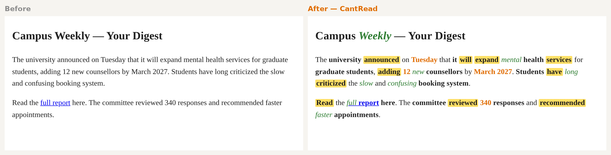

<!-- 自动生成，请勿直接修改。源文件：scripts/readme-src/README.md，运行 npm run readme 重新生成。 -->
<!-- Generated file — edit scripts/readme-src/README.md and run "npm run readme". -->

# CantRead

**English** | [简体中文](README.zh-CN.md)

**For brains that bounce off walls of text.**

> 💡 This README is formatted by CantRead's own engine — you are reading TABE right now. Prefer plain text? Read the [unformatted version](scripts/readme-src/README.md).

**CantRead** <mark>turns</mark> **grammar** into *visual* **signals**. **It** <mark>works</mark> *like* **syntax** <mark>highlighting</mark>, but for *natural* **language**: **your eyes** <mark>get</mark> **places** to <mark>land</mark>, so **you** <mark>can scan</mark> the **shape** of a **sentence** first and <mark>decide</mark> whether to <mark>read</mark> *closely*.



| Layer | Style | Role |
|---|---|---|
| **Nouns** | **bold** | Labels — what the sentence is about |
| <mark>Verbs</mark> | <mark>yellow highlight</mark> | Actions — what happened |
| *Adjectives / adverbs* | *green italic* | Details — the supplements |
| Numbers | orange | Quantities and dates |

> On GitHub, text colors are not allowed, so adjectives show as plain italic and numbers stay unformatted here. In the browser extension you get the full colors.

The **format** <mark>is</mark> *called* **TABE**. **It** <mark>grew out</mark> of the **notes** the **author**, **Ahui** (**dyslexia + ADHD**), <mark>wrote</mark> while **job hunting**, and **it** <mark>turned out</mark> to <mark>help</mark> **anyone** who <mark>finds</mark> *dense* **text** *hard* to <mark>start</mark>.

---

## Products

**CantRead** <mark>is</mark> one **project** with several **products**. **They** *all* <mark>share</mark> the *same* **TABE engine** in [`packages/core/`](packages/core/).

| Product | Status | Where | Install |
|---|---|---|---|
| 🦊 **Firefox extension** — web pages, email, newsletters | ✅ v1.0 · in store review | [`packages/firefox-extension/`](packages/firefox-extension/) | [Guide](packages/firefox-extension/README.md#install) |
| 🌐 **Chrome / Edge extension** | 📋 Planned | — | — |
| 🟣 **Obsidian plugin** — your notes in Reading View | ✅ v0.1.1 | [`tabe-reader/`](tabe-reader/) | [Guide](#obsidian-plugin) |
| 🧪 **Web demo** — paste text and try it | ✅ Live | [`docs/`](docs/) | <https://oldmercy.github.io/CantRead/> |
| 📄 **PDF / paper reading, ADHD read-along…** | 📋 Planned | — | See the [roadmap](ROADMAP.md) |

👉 **What comes next:** <mark>see</mark> [**ROADMAP.md**](ROADMAP.md). The **direction** <mark>is</mark> **browser** first — *most* **reading** <mark>happens</mark> in the **browser**, and an **extension** <mark>asks</mark> **you** to <mark>import</mark> **nothing**.

---

## Firefox extension

<mark>Click</mark> the **toolbar icon** and the *current* **page** <mark>is</mark> *highlighted*. **You** <mark>can turn</mark> each **layer** on or off, <mark>press</mark> `Alt+Shift+H` (`⌥⇧H` on **Mac**) to **toggle**, or <mark>select</mark> some **text** and *right*-**click** to <mark>highlight</mark> *just* that **part**. **Everything runs on your device and no data is collected.**

*Full* <mark>install</mark> and **usage guide**: [packages/firefox-extension/README.md](packages/firefox-extension/README.md)

---

## Obsidian plugin

The **plugin** <mark>formats</mark> **notes** in **Obsidian's** **Reading View** *automatically* and never <mark>changes</mark> **your source files**.

**Install with BRAT**

1. In **Obsidian**, <mark>install</mark> the **BRAT plugin**: `Settings → Community Plugins → Browse → BRAT`
2. *Open* `BRAT → Add Beta Plugin` and <mark>enter</mark> `https://github.com/oldmercy/CantRead`
3. <mark>Enable</mark> **TABE Reader** *under* **Community Plugins**, *then* <mark>open</mark> any **note** in **Reading View**

**Manual install:** <mark>copy</mark> `main.js`, `manifest.json` and `styles.css` from [`tabe-reader/`](tabe-reader/) into `.obsidian/plugins/tabe-reader/`, *then* <mark>enable</mark> **it** *under* **Community Plugins**.

**Usage:** `⌘⇧T` **toggles** the **formatting**, `⌘⇧A` <mark>switches</mark> **AI mode**, and `Settings → TABE Reader` <mark>lets</mark> **you** <mark>turn</mark> each **layer** on or off.

> 📦 **Looking for the original Obsidian-only snapshot of this repository?** Pick tag **`0.1.1`** under [Tags](https://github.com/oldmercy/CantRead/tags). That version stays exactly as it was.

### Three routes (Obsidian plugin)

- **Route A · Bionic** — **bolds** the first **letters** of each **word**, with no **grammar analysis**, *fully offline*
- **Route B · Local NLP (default)** — *English* <mark>uses</mark> [compromise.js](https://github.com/spencermountain/compromise) and **Chinese** <mark>uses</mark> a **rule engine**; *free*, *offline*, no **API key**
- **Route C · AI (optional)** — <mark>connects</mark> to **OpenAI**, **Claude** or **Ollama** with **your** *own* **API key**, which <mark>stays</mark> on **your device**

| Provider | Default model | API key |
|---|---|---|
| OpenAI | `gpt-4o-mini` | `sk-…` |
| Claude | `claude-3-5-haiku-20241022` | `sk-ant-…` |
| Custom / Ollama | `llama3` | optional |

---

## Languages

- **English** — **part**-of-**speech** <mark>tagging</mark> with **compromise.js**, *fairly accurate*
- **Chinese** — a **rule engine** with a <mark>built</mark>-in **dictionary**, *still* <mark>improving</mark>
- **Mixed text** — <mark>detected</mark> *automatically* and <mark>handled</mark> **paragraph** by **paragraph**

---

## Repository layout

```
CantRead/
├── packages/
│   ├── core/               TABE engine (shared by every product)
│   └── firefox-extension/  Browser extension
├── tabe-reader/            Obsidian plugin
├── docs/                   Web demo (GitHub Pages)
├── prototypes/             ADHD reading-aid experiments
├── scripts/readme-src/     Plain sources of these READMEs
└── ROADMAP.md              Roadmap
```

**Development:** <mark>run</mark> `npm install`, *then* `npm run build` to <mark>build</mark> the **engine** and the **extension**, *then* `npm test`. After <mark>editing</mark> a **README source**, <mark>run</mark> `npm run readme` to <mark>regenerate</mark> the <mark>formatted</mark> **files**. Each **product folder** <mark>has</mark> **its** *own* **README** with **details**.

---

## Contributing

**Issues** and <mark>pull</mark> **requests** <mark>are</mark> **welcome** — *especially* **Chinese dictionary additions**, <mark>support</mark> for *new* **languages**, and *real* **feedback** like "**it** <mark>works</mark> *badly* on this **kind** of **page**". <mark>Open</mark> one [here](https://github.com/oldmercy/CantRead/issues).

**MIT License · Made** by **Ahui** ([@oldmercy](https://github.com/oldmercy))
